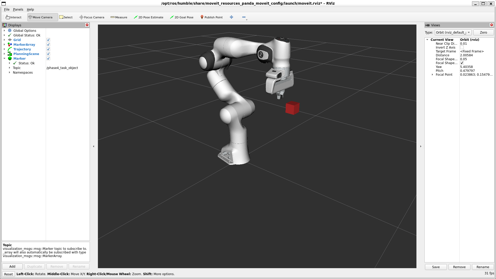
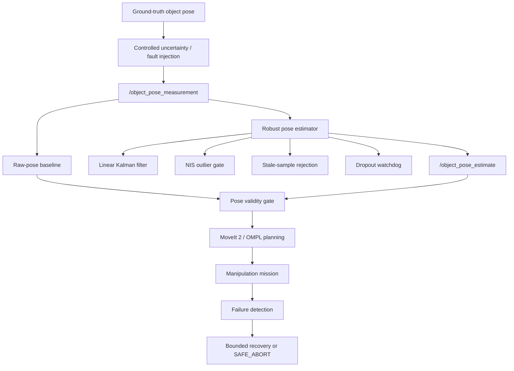
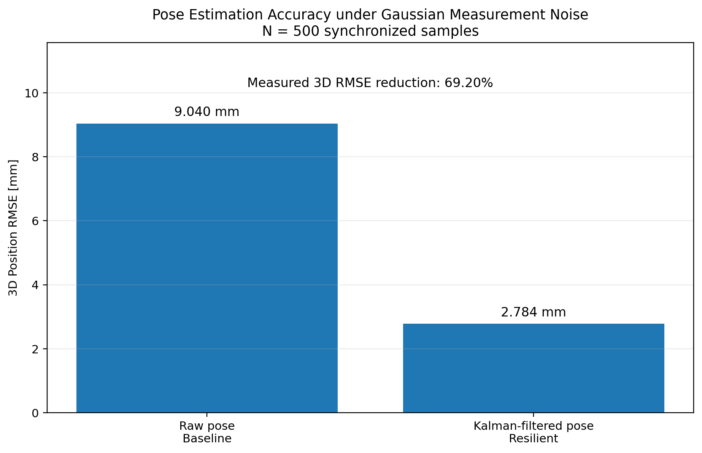
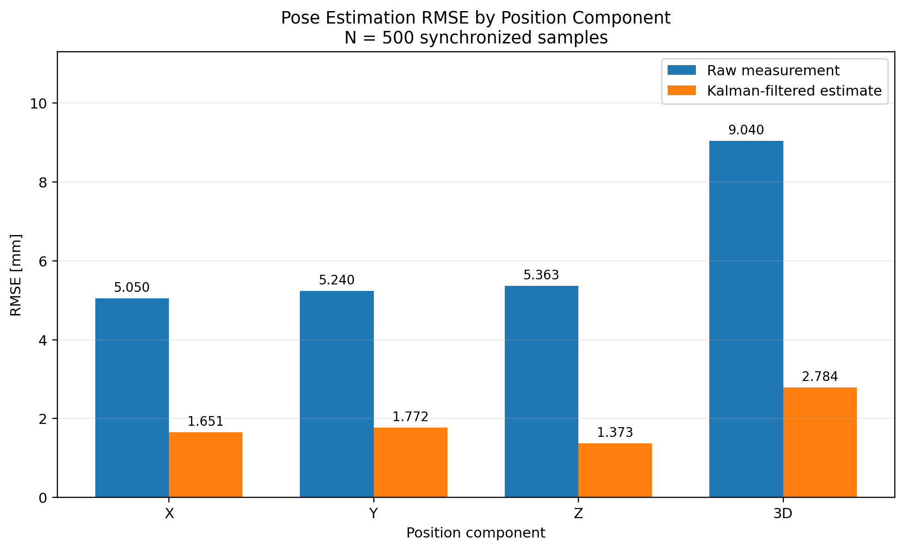
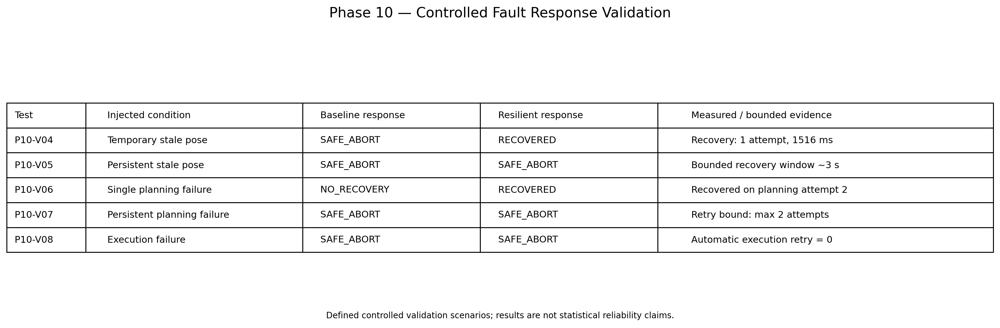
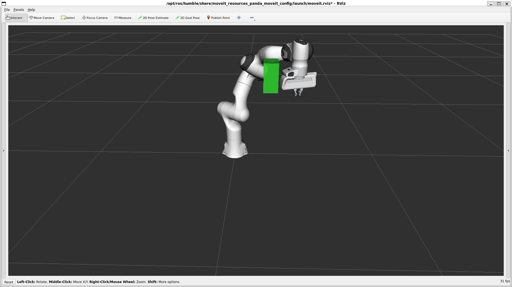
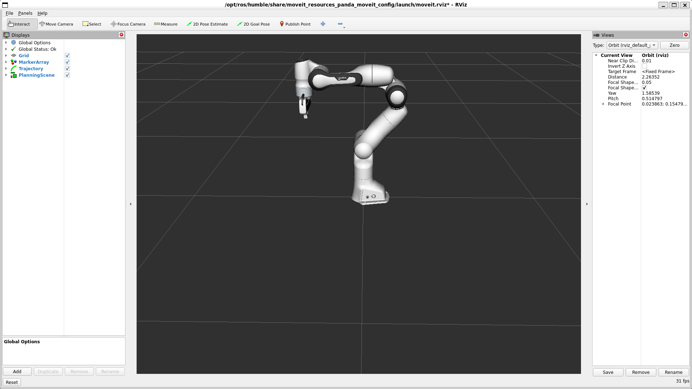
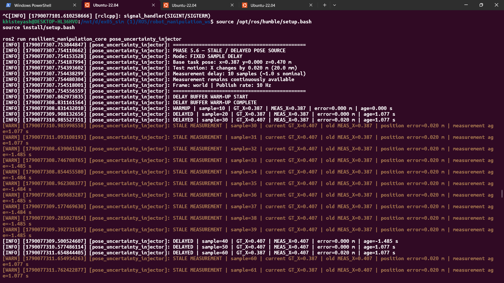

# ROS2 Resilient Manipulation & Motion Planning Testbed

[](https://docs.ros.org/en/humble/)
[](https://moveit.picknik.ai/)


**Collision-aware manipulation with robust object-pose estimation and bounded recovery under controlled perception, planning and execution faults.**

Built with **ROS 2 Humble, C++17, MoveIt 2, OMPL and Python-based validation** using the Franka Emika Panda simulation stack.



---

## Engineering results

| Pose estimation | Fault response | Verification |
|---|---|---|
| **9.040 → 2.784 mm** 3D RMSE | **Recovered** temporary stale-pose fault | **6 / 6** automated regression scenarios PASS |
| **69.20% RMSE reduction** | **Recovered** single planning failure on retry | **8 / 8** engineering requirements PASS |
| **20 / 20** controlled outliers rejected/protected | Persistent faults terminate through **bounded SAFE_ABORT** | Requirement-to-test traceability included |

The pose-estimation result was measured over **500 synchronized ground-truth / raw / estimated samples**.

> **Core engineering question:** How can a manipulation pipeline continue safely when object-pose data becomes noisy, stale, delayed or corrupted — while still exposing persistent failures instead of hiding them?

---

## System architecture



The **baseline and resilient configurations use the same mission implementation**. Resilience is enabled through runtime configuration rather than through two separate mission programs.

---

## What I implemented

- ROS 2 / C++ manipulation nodes and launch integration
- Panda joint-state monitoring
- joint-space and Cartesian planning with MoveIt 2
- collision-object insertion and collision-aware planning
- estimate-driven pre-grasp, grasp and retreat target generation
- controlled Gaussian noise, bias, outlier, dropout and delay injection
- Cartesian-position Kalman filtering
- NIS-based outlier rejection
- stale-data rejection and dropout monitoring
- bounded perception and planning recovery
- explicit safe-abort handling for persistent and execution-level faults
- automated scenario regression
- baseline-vs-resilient engineering validation
- quantitative analysis, plots and requirement traceability

Motion planning uses **MoveIt 2 with existing OMPL planners**. This project does **not** claim a custom RRT implementation.

---

## Manipulation mission

```text
Ready
  ↓
Open gripper
  ↓
Estimate-driven pre-grasp
  ↓
Cartesian approach
  ↓
Close gripper
  ↓
Cartesian retreat
  ↓
Return to ready
  ↓
Mission verification
```

The task targets are generated from the accepted object-pose input rather than from a fixed hard-coded grasp location.

▶️ [Watch the manipulation mission demo](docs/evidence/manipulation_mission_demo.mp4)

---

## Pose estimation and uncertainty handling

The estimator uses **three independent scalar random-walk Kalman filters** for Cartesian position.

A standard linear Kalman filter is intentional here because the implemented process and measurement models are linear.

### Measured accuracy

| Component | Raw RMSE | Filtered RMSE |
|---|---:|---:|
| X | 5.050 mm | **1.651 mm** |
| Y | 5.240 mm | **1.772 mm** |
| Z | 5.363 mm | **1.373 mm** |
| **3D** | **9.040 mm** | **2.784 mm** |

**3D RMSE reduction: 69.20%**





### Verified estimator settings

| Parameter | Value |
|---|---:|
| Process-noise variance `Q` | `1e-6 m²` |
| Measurement-noise variance `R` | `2.5e-5 m²` |
| Approx. steady-state Kalman gain | `0.181` |
| NIS rejection threshold | `11.345` |
| Stale raw-sample threshold | `300 ms` |
| Dropout watchdog | `250 ms` |

In the defined controlled outlier experiment, **20 / 20 injected outliers were detected and prevented from corrupting the estimate**.

Detailed estimator equations and implementation notes:  
[`docs/pose_estimation.md`](docs/pose_estimation.md)

---

## Baseline vs resilient behavior

| Scenario | Baseline | Resilient system |
|---|---|---|
| Nominal fresh pose | Mission completes | Mission completes |
| Gaussian pose noise | Raw pose used | Kalman-filtered estimate used |
| Controlled outlier | No estimator protection | NIS gate protects estimate |
| Temporary stale pose | SAFE_ABORT | **RECOVERED** |
| Persistent stale pose | SAFE_ABORT | **Bounded SAFE_ABORT** |
| Single planning failure | No retry | **RECOVERED on attempt 2** |
| Persistent planning failure | Abort | **Bounded SAFE_ABORT after max. 2 attempts** |
| Execution failure | SAFE_ABORT | **SAFE_ABORT — no blind retry** |



A key design choice is that **recovery is bounded**. The objective is not to force success after every fault; persistent or execution-level failures are surfaced and terminate through controlled safe-abort behavior.

---

## Automated verification

### Regression suite

The automated regression covers six controlled scenarios:

| ID | Scenario | Expected behavior |
|---|---|---|
| P9-S01 | Nominal fresh pose | Mission completes |
| P9-S02 | Temporary stale → fresh | Recovery + mission completion |
| P9-S03 | Persistent stale | Bounded SAFE_ABORT |
| P9-S04 | Single planning failure | One retry → recovery |
| P9-S05 | Persistent planning failure | Bounded SAFE_ABORT |
| P9-S06 | Execution failure | SAFE_ABORT, no automatic retry |

**Final result: 6 / 6 PASS**

Run:

```bash
python3 src/resilient_manipulation_core/test/phase9/batch_regression.py
```

### Engineering validation

Eight requirements validate nominal behavior, pose-estimation accuracy, outlier rejection, perception recovery, planning recovery and execution-failure handling.

**Final result: 8 / 8 requirements PASS**

- [Engineering validation report](src/resilient_manipulation_core/test/phase10/results/phase10_engineering_validation_report.md)
- [Requirement traceability](src/resilient_manipulation_core/test/phase10/results/phase10_requirement_traceability.md)

---

## ROS 2 executables

| Executable | Purpose |
|---|---|
| `panda_state_monitor` | Panda joint-state monitoring |
| `joint_space_planner` | Joint-space planning baseline |
| `cartesian_path_planner` | Cartesian end-effector path generation |
| `obstacle_avoidance_planner` | Collision-aware planning |
| `pose_uncertainty_injector` | Controlled perception-fault injection |
| `pose_filter` | Kalman filtering, NIS gating and stale-data protection |
| `pose_estimation_validator` | Raw vs estimated pose validation |
| `pose_bias_validator` | Systematic-bias evaluation |
| `pose_outlier_validator` | Controlled outlier validation |
| `pose_visualizer` | RViz diagnostic markers |
| `manipulation_mission` | Estimate-driven mission and bounded recovery |

Important interfaces:

```text
/object_pose_ground_truth
/object_pose_measurement
/object_pose_estimate
/manipulation_task_targets
/resilient_manipulation/pose_markers
/joint_states
```

Planning frame: `world`  
End-effector link: `panda_link8`

---

## Build and run

### Requirements

- Ubuntu 22.04
- ROS 2 Humble
- MoveIt 2
- `moveit_resources_panda_moveit_config`
- C++17
- Python 3
- colcon
- matplotlib

### Build

```bash
source /opt/ros/humble/setup.bash

colcon build --packages-select resilient_manipulation_core

source install/setup.bash
```

### Start Panda + MoveIt 2 + RViz

```bash
ros2 launch moveit_resources_panda_moveit_config demo.launch.py
```

### Load the validated execution profile

```bash
ros2 param load \
/moveit_simple_controller_manager \
src/resilient_manipulation_core/config/moveit_execution_profile.yaml
```

Validated execution parameters:

```text
allowed_execution_duration_scaling = 2.5
allowed_goal_duration_margin       = 1.0
```

### Run the resilient mission

```bash
ros2 launch resilient_manipulation_core manipulation_mission.launch.py
```

### Run the baseline ablation

```bash
ros2 launch \
resilient_manipulation_core \
manipulation_mission.launch.py \
object_pose_topic:=/object_pose_measurement \
resilience_enabled:=false
```

---

## Engineering evidence

| Collision-aware planning | Panda / MoveIt baseline |
|:---:|:---:|
|  |  |

| Manipulation mission | Stale-pose protection |
|:---:|:---:|
|  |  |

---

## Repository structure

```text
.
├── analysis/                         # Quantitative analysis scripts
├── docs/
│   ├── evidence/                    # Curated visual evidence
│   └── pose_estimation.md
├── results/
│   ├── phase6_estimation/
│   ├── phase6_outlier/
│   └── phase8_recovery/
└── src/
    └── resilient_manipulation_core/
        ├── config/
        ├── launch/
        ├── src/
        ├── test/
        │   ├── phase9/
        │   └── phase10/
        ├── CMakeLists.txt
        └── package.xml
```

---

## Scope

This is a **simulation-based manipulation and software-validation testbed** designed for repeatable fault-injection experiments. Current validation focuses on Cartesian position estimation and software-level recovery with a simulated Panda manipulator; hardware perception and physical-robot experiments are outside the present scope.

---

## Author

**Yash Khiste**  
M.Sc. Electrical Engineering and Information Technology  
Otto von Guericke University Magdeburg
